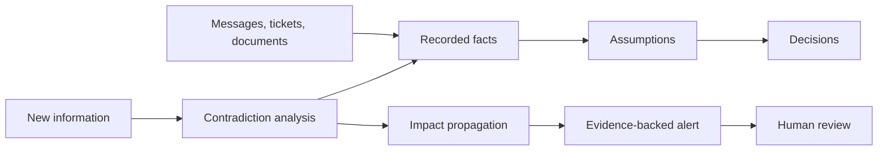
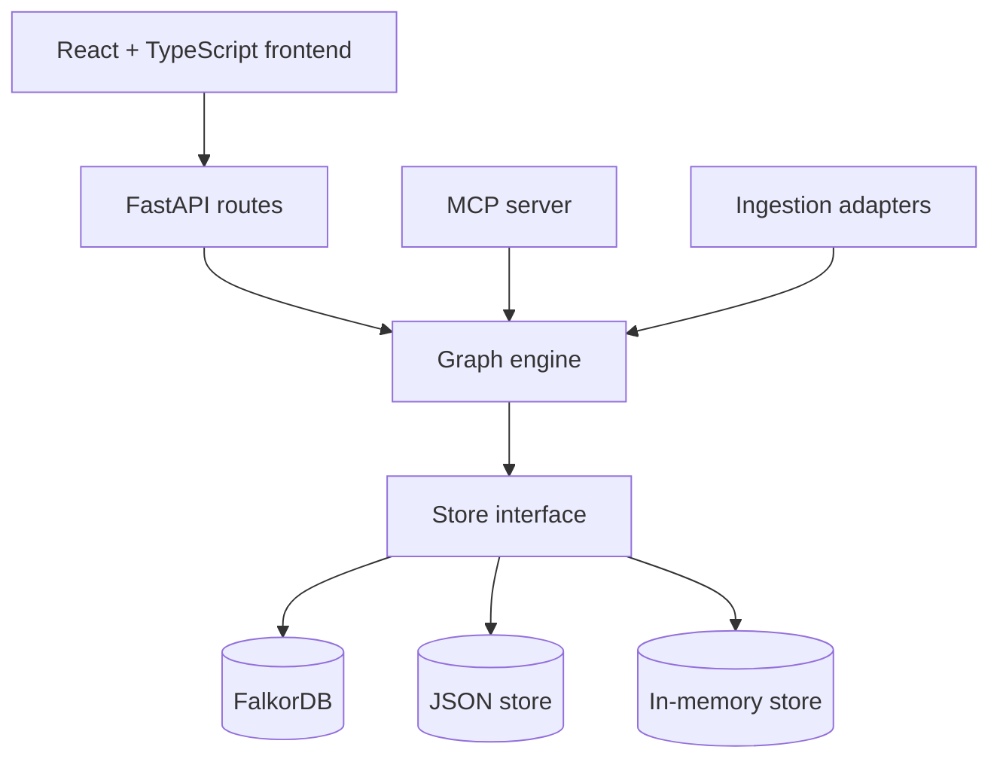

<div align="center">


# Tripwire

### Decision intelligence for changing facts.


Tripwire connects decisions to the assumptions, facts, and source records behind them. When new information challenges an underlying fact, Tripwire traces the impact and gives people the evidence they need to review it.

<br>


**Traceable knowledge · Evidence-led analysis · Human-controlled review**
<br>


</div>

---

## Contents

- [Why Tripwire](#why-tripwire)
- [How it works](#how-it-works)
- [Explore the application](#explore-the-application)
- [Quick start](#quick-start)
- [Run with Docker Compose](#run-with-docker-compose)
- [Frontend modes](#frontend-modes)
- [API reference](#api-reference)
- [Configuration](#configuration)
- [Architecture](#architecture)
- [Development](#development)
- [Troubleshooting](#troubleshooting)
- [Project structure](#project-structure)
- [Documentation](#documentation)

## Why Tripwire

Business decisions depend on facts and assumptions that can change after a decision is made. Those changes are easy to miss when the evidence is scattered across messages, documents, and tickets.

Tripwire creates a graph of those dependencies. When new information conflicts with a recorded fact, it can show:

| Question | Tripwire provides |
|---|---|
| What changed? | The new information and the earlier fact it challenges |
| What may be affected? | The assumptions and decisions reachable through recorded relationships |
| Why is it flagged? | Evidence paths, relationship context, and confidence |
| Who can review it? | People ranked by recorded contributions to relevant systems and projects |
| What did we know then? | A history reconstructed from recorded time, separate from real-world validity |

> [!IMPORTANT]
> Tripwire supports human review. It does not silently decide that a business decision is invalid.

### A concrete example

In the Northwind Labs demo, a hosting partner loses an EU compliance certification. A launch decision that depends on EU data residency is flagged for review. An independent SOC 2 attestation still supports the underlying assumption, so the impact is treated as **potentially stale** rather than automatically declared stale. The alert includes the evidence and leaves the final decision to a person.

## How it works



The engine follows explicit graph relationships. It keeps the original fact and its history, checks alternate supporting evidence, and returns the path behind each affected entity. It does not invent missing connections.

### Two clocks, kept separate

Tripwire records both:

- **Valid time** — when a fact applies in the world (`valid_from`, `valid_to`).
- **Recorded time** — when Tripwire learned or changed its belief (`recorded_at`, `recorded_to`).

That distinction makes it possible to ask what was believed on a past date without rewriting history using today’s graph.

## Explore the application

| Workspace | Purpose |
|---|---|
| **Command Center** | See service mode, graph size, open alerts, and decisions needing attention. |
| **Knowledge Graph** | Search entities, explore relationships, and inspect a selected entity. |
| **Decision Explorer** | Review decision status, dependencies, evidence, and explanation paths. |
| **Alerts & Review** | Inspect impact, record a review note, and apply an allowed transition. |
| **Evidence** | Read source records and follow provenance chains. |
| **Experts** | Find people based on recorded contribution to a system or topic. |
| **History** | Inspect recorded beliefs at a chosen time and browse activity. |
| **Scenario Lab** | Run the deterministic Frankfurt event and inspect its propagation result. |

## Quick start

### Requirements

- Python **3.10 or later**
- Node.js and npm for the web interface
- Docker Compose only if using the FalkorDB stack

The API and deterministic demo do not require an LLM key. The JSON-backed setup below also works without Docker.

### 1. Start the API with the local JSON store

From the repository root, create a virtual environment and install the backend dependencies:

```powershell
python -m venv .venv
.\.venv\Scripts\Activate.ps1
python -m pip install -r requirements.txt
```

Choose the JSON store, seed the Northwind Labs dataset, and start the API:

```powershell
$env:TRIPWIRE_STORE = "json"
python -m tripwire seed
python -m uvicorn tripwire.api.app:app --host 127.0.0.1 --port 8000
```

The API listens at `http://127.0.0.1:8000`. Open [`/docs`](http://127.0.0.1:8000/docs) for interactive API documentation or [`/api/health`](http://127.0.0.1:8000/api/health) to check the active backend.

To try the headline event, open another terminal in the repository and activate the same virtual environment:

```powershell
python -m tripwire state
python -m tripwire trigger-event frankfurt_compliance_revoked
```

### 2. Start the web interface

In a second terminal:

```powershell
cd frontend
npm ci
$env:VITE_API_MODE = "live"
$env:VITE_API_BASE_URL = "http://localhost:8000"
npm run dev
```

Open the local URL printed by Vite, usually `http://localhost:5173`.

<details>
<summary><strong>macOS or Linux commands</strong></summary>

```bash
python3 -m venv .venv
source .venv/bin/activate
python -m pip install -r requirements.txt
export TRIPWIRE_STORE=json
python -m tripwire seed
python -m uvicorn tripwire.api.app:app --host 127.0.0.1 --port 8000
```

In another terminal:

```bash
cd frontend
npm ci
VITE_API_MODE=live VITE_API_BASE_URL=http://localhost:8000 npm run dev
```

</details>

## Run with Docker Compose

The Compose file starts FalkorDB and the API. It configures the API to seed the demo dataset on startup and to fall back to the JSON store if FalkorDB is unreachable.

```bash
docker compose up --build
```

The API is available on port `8000`; FalkorDB is exposed on port `6379`. To stop the services:

```bash
docker compose down
```

To remove the persisted FalkorDB volume as well, use `docker compose down --volumes`. This permanently deletes the local database volume.

## Frontend modes

The frontend’s `VITE_API_MODE` setting controls how it connects to data:

| Mode | Behavior |
|---|---|
| `live` | Connect to `VITE_API_BASE_URL`. Connection failures are shown in the interface. |
| `mock` | Use the bundled deterministic reference engine in `mock-backend/`. |
| `auto` | Probe the API and fall back to the reference engine when it is unavailable. This is the default. |

For live mode, set `VITE_API_BASE_URL` to the API origin, such as `http://localhost:8000`. The interface displays the active mode so reference data is not confused with live data.

## API reference

The full contract—including response models, query parameters, error shapes, and field semantics—is documented in [`docs/API_CONTRACT.md`](docs/API_CONTRACT.md). The running API also serves interactive OpenAPI documentation at `/docs`.

| Endpoint | Description |
|---|---|
| `GET /api/health` | Health, active backend, and dataset status |
| `GET /api/graph` | Graph nodes, edges, and revision |
| `GET /api/entities` | Entity collections and counts |
| `GET /api/search` | Search entities by text |
| `GET /api/decisions` | List decisions |
| `GET /api/decisions/{id}/explanation` | Explain a decision and its evidence paths |
| `GET /api/decisions/{id}/dependencies?at=...` | Inspect dependencies at a recorded time |
| `POST /api/decisions/{id}/status` | Apply an audited decision status change |
| `GET /api/alerts` | List alerts and available review transitions |
| `GET /api/alerts/{id}` | Fetch an alert and its affected entities |
| `GET /api/alerts/{id}/history` | Read an alert’s review history |
| `POST /api/alerts/{id}/review` | Record an allowed review transition and note |
| `GET /api/history/belief?at=...` | Reconstruct recorded beliefs at a transaction time |
| `GET /api/history/valid?at=...` | Query facts valid at a real-world time |
| `GET /api/history/changes?since=...` | Read facts and events recorded after a point in time |
| `GET /api/experts` | Rank contributors by recorded work |
| `POST /api/demo/trigger-event` | Run a scenario and return its propagation result |

Example request:

```bash
curl 'http://127.0.0.1:8000/api/decisions?status=ACTIVE&limit=2'
```

The exact list filters and response envelopes are defined in the API contract; use that document as the source of truth when integrating a client.

## Configuration

Settings are read from environment variables. The repository includes [`.env.example`](.env.example) as a starting point; keep credentials in environment configuration, not source files.

| Variable | Default | Purpose |
|---|---|---|
| `TRIPWIRE_STORE` | `falkordb` | Select `falkordb`, `json`, or `memory`. |
| `TRIPWIRE_STORE_FALLBACK` | `true` | Use the JSON store if FalkorDB cannot be reached. |
| `TRIPWIRE_STATE_PATH` | `data/graph.json` | Path used by the JSON store. |
| `FALKOR_HOST` | `localhost` | FalkorDB hostname. |
| `FALKOR_PORT` | `6379` | FalkorDB port. |
| `FALKOR_GRAPH` | `tripwire` | FalkorDB graph name. |
| `TRIPWIRE_CORS_ORIGINS` | Local development origins | Comma-separated browser origins allowed by the API. |
| `TRIPWIRE_SEED_ON_STARTUP` | `false` | Seed the demo dataset when the API starts. |
| `LLM_PROVIDER` | Unset | Optional provider for free-text extraction. |
| `LLM_API_KEY` | Unset | Optional provider credential. |
| `LLM_MODEL` | Unset | Optional model identifier. |
| `LLM_BASE_URL` | Unset | Optional OpenAI-compatible endpoint. |

With `LLM_PROVIDER` unset, deterministic extraction is used. Claims produced by that path remain marked for review rather than being represented as verified.

## Architecture



### Backend

- `tripwire/core/` contains the graph model, store abstractions, contradiction analysis, impact propagation, history, alerts, explanations, and expert ranking.
- `tripwire/ingest/` contains source adapters and extraction pipelines for messages, tickets, PRDs, and meeting notes.
- `tripwire/api/` exposes the engine through FastAPI routes and validated schemas.
- `tripwire/mcp_server/` exposes engine capabilities through MCP tools.
- `tripwire/dataset/` defines the deterministic Northwind Labs demonstration data.

### Frontend

The React and TypeScript application is built with Vite. It can connect to the live API or use `mock-backend/`, a deterministic reference engine used for offline demonstrations and frontend development.

## Development

### Backend tests

From the repository root, install development dependencies and run pytest:

```powershell
python -m pip install -r requirements-dev.txt
python -m pytest -q
```

### Frontend checks

From `frontend/`:

```bash
npm run typecheck
npm run build
npm test
```

Playwright end-to-end tests are available separately:

```bash
npm run e2e:install
npm run e2e
```

The end-to-end suite uses the frontend’s configured demo flow. Run the API separately when validating live integration.

## Troubleshooting

<details>
<summary><strong>The web app shows mock or reference data</strong></summary>

Check `VITE_API_MODE` and `VITE_API_BASE_URL`. Use `live` mode to surface connection errors directly, and confirm that the API is reachable at the configured origin. In `auto` mode, an unavailable API causes the frontend to use its bundled reference engine.

</details>

<details>
<summary><strong>The API starts with an empty graph</strong></summary>

Seed the dataset with `python -m tripwire seed`, or set `TRIPWIRE_SEED_ON_STARTUP=true` before starting the API. Confirm the active store in `GET /api/health`.

</details>

<details>
<summary><strong>FalkorDB cannot be reached</strong></summary>

Confirm that the service is running and that `FALKOR_HOST` and `FALKOR_PORT` match its address. When `TRIPWIRE_STORE_FALLBACK=true`, the API can fall back to the JSON store; check `/api/health` to see which store is active.

</details>

<details>
<summary><strong>Browser requests are blocked by CORS</strong></summary>

Add the frontend origin to `TRIPWIRE_CORS_ORIGINS`. For local Vite development, this is commonly `http://localhost:5173` (or the port printed by Vite).

</details>

## Project structure

```text
graphhacks/
├── tripwire/
│   ├── api/             FastAPI application, routers, and schemas
│   ├── core/            Graph engine, stores, and reasoning
│   ├── dataset/         Deterministic Northwind Labs data
│   ├── ingest/          Adapters and extraction pipelines
│   └── mcp_server/      MCP server and tools
├── frontend/            React, TypeScript, and Vite application
├── mock-backend/        Offline frontend reference engine
├── tests/               Backend test suite
├── docs/                 API, schema, architecture, dataset, and MCP guides
├── scripts/              Local run and development helpers
└── data/                 Local runtime state (gitignored)
```

## Documentation

| Guide | Details |
|---|---|
| [API contract](docs/API_CONTRACT.md) | Endpoints, schemas, validation, and field semantics |
| [Graph schema](docs/GRAPH_SCHEMA.md) | Node types, relationship types, properties, and statuses |
| [Architecture](docs/ARCHITECTURE.md) | Engine layers, stores, and extension points |
| [Dataset](docs/DATASET.md) | Northwind Labs entities and scenario relationships |
| [MCP guide](docs/MCP.md) | MCP server setup and available tools |

---

<div align="center">

**Tripwire makes decision dependencies visible, so people can respond when the facts move.**

</div>
