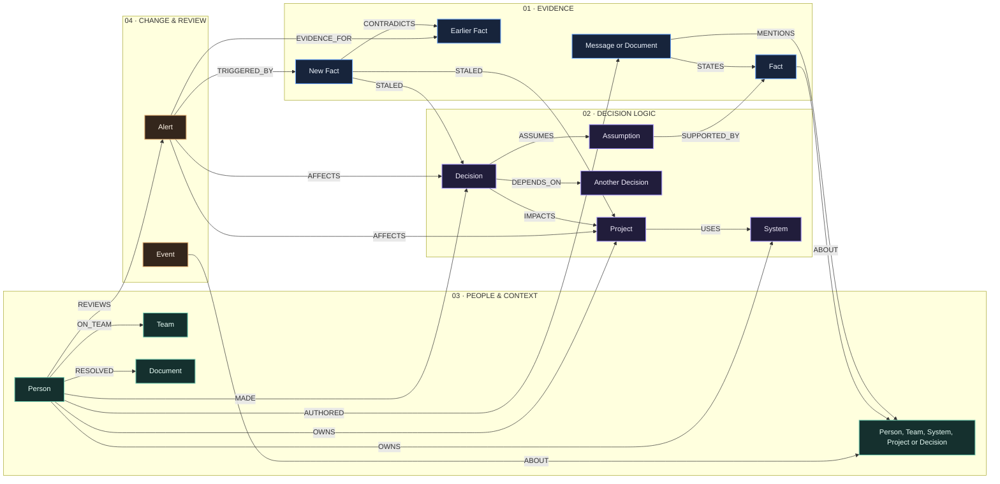
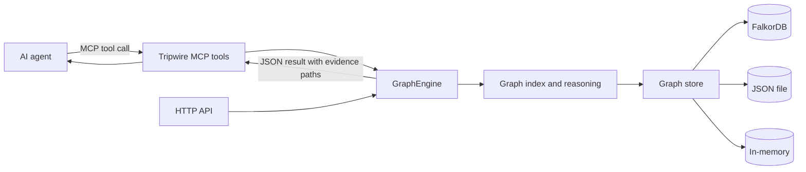
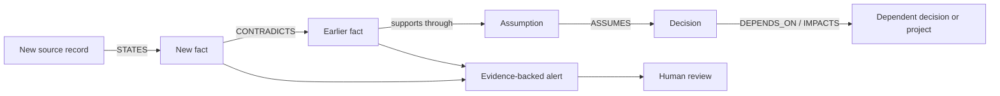
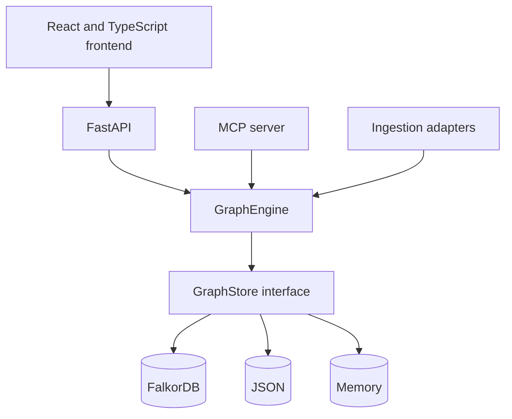

<div align="center">

# Tripwire

### Decision intelligence for changing facts.

Tripwire connects business decisions to the assumptions, facts, and source records behind them. When new information challenges a fact, it traces the graph to show what may need review—and why.

<br>


**Traceable knowledge · Evidence-led analysis · Human-controlled review**

</div>

---

## Contents

- [At a glance](#at-a-glance)
- [The graph](#the-graph)
- [How an agent queries the graph](#how-an-agent-queries-the-graph)
- [How impact analysis works](#how-impact-analysis-works)
- [Explore the application](#explore-the-application)
- [Run locally](#run-locally)
- [Configuration](#configuration)
- [API](#api)
- [Architecture](#architecture)
- [Development](#development)
- [Project map](#project-map)
- [Documentation](#documentation)

## At a glance

Decisions are made using facts that can change. Tripwire records the reasoning behind those decisions as a graph, then follows explicit relationships when new evidence arrives.

| Question | What Tripwire shows |
| --- | --- |
| What changed? | The new fact and the earlier fact it challenges |
| What could be affected? | Connected assumptions, decisions, and projects |
| Why was it flagged? | Evidence, relationship paths, and certainty |
| Who can review it? | People ranked from recorded contribution evidence |
| What did we believe then? | Facts reconstructed using recorded time |

Tripwire supports human review. It does not silently decide that a business decision is invalid.

## The graph

The graph connects organizational context, decisions, evidence, and review activity. Arrows show the stored direction of each relationship.



### Node types

| Group | Nodes | What they represent |
| --- | --- | --- |
| Organization | `Person`, `Team` | People, team membership, ownership, and review responsibility |
| Business context | `System`, `Project` | Services or partners, and the initiatives that use or depend on them |
| Reasoning | `Decision`, `Assumption` | Recorded choices and the claims those choices rely on |
| Evidence | `Fact`, `Message`, `Document` | Time-aware claims and the source records that support them |
| Operations | `Event`, `Alert` | Audit history and reviewable impact notifications |

`Message` represents chat or webhook-shaped evidence. `Document` represents tickets, PRDs, meeting notes, and design documents. `Alert` is a first-class review record, distinct from an audit `Event`.

### Relationship types

| Relationship | Direction | Meaning |
| --- | --- | --- |
| `ON_TEAM` | Person → Team | Membership |
| `MADE` | Person → Decision | Decision maker |
| `ASSUMES` | Decision → Assumption | Rationale used by a decision |
| `SUPPORTED_BY` | Assumption → Fact | Evidence supporting an assumption |
| `DEPENDS_ON` | Decision → Decision | Decision dependency |
| `IMPACTS` | Decision → Project | Project affected by a decision |
| `USES` | Project → System | System used by a project |
| `STATES` | Message/Document → Fact | Source record asserting a fact |
| `CONTRADICTS` | Fact → Fact | New fact challenges an earlier fact |
| `AUTHORED` | Person → Message/Document | Source author |
| `ABOUT` | Event → Entity; Fact → Subject | Entity described by a record or claim |
| `TRIGGERED_BY` | Alert → Fact | Fact that triggered an alert |
| `STALED` | Fact → Decision/Project | Fact that caused a stale review flag |
| `MENTIONS` | Message/Document → Entity | Entity discussed in a source |
| `RESOLVED` | Person → Document | Person who resolved a ticket |
| `OWNS` | Person → System/Project | Official ownership |
| `REVIEWS` | Person → Alert | Assigned reviewer |
| `AFFECTS` | Alert → Decision/Project | Potentially affected entity, with certainty |
| `EVIDENCE_FOR` | Alert → Fact | Fact included as alert evidence |

The graph stores both **valid time** (when a fact applies in the world) and **recorded time** (when Tripwire learned or changed its belief). This supports historical questions without rewriting what was known at the time.

## How an agent queries the graph

An agent uses Tripwire’s MCP tools. Each tool validates its input and calls the same `GraphEngine` used by the HTTP API. The engine queries the configured graph store and returns structured results with paths and source evidence.



Typical agent queries:

| Agent question | Tool | Graph work |
| --- | --- | --- |
| “What do we know about this system?” | `search_knowledge` | Searches names, claims, and source text |
| “What does this decision rely on?” | `explain_decision` | Follows `ASSUMES`, `SUPPORTED_BY`, and dependency paths |
| “Does this new claim conflict with existing evidence?” | `find_contradictions` | Compares a candidate with related facts and returns contradiction paths |
| “What might this change affect?” | `propagate_staleness` | Traverses supporting assumptions and dependent decisions; dry-run is the default |
| “Why was this alert raised?” | `explain_alert` | Reconstructs its trigger, evidence, affected entities, and review history |
| “What did we believe on a past date?” | `history_query` | Filters facts by recorded time or valid time |
| “Who has worked on this system?” | `find_experts` | Ranks people from contribution and ownership relationships |

The MCP layer does not implement a separate graph or reasoning system. An MCP result and an API result come from the same engine and store.

## How impact analysis works

In the Northwind Labs demo, a hosting partner’s compliance certification is revoked. Tripwire records the new claim, checks it against the earlier fact, traces connected assumptions to decisions and projects, and returns an alert with the evidence path.



The engine checks for alternate supporting evidence and reports certainty as `potential` or `confirmed`. Propagation can flag an item as `POTENTIALLY_STALE`; a person must explicitly confirm an alert before a decision becomes `STALE`.

## Explore the application

| Workspace | Use it to |
| --- | --- |
| **Command Center** | See graph health, open alerts, and decisions needing attention |
| **Knowledge Graph** | Search entities and inspect their relationships |
| **Decision Explorer** | Review a decision’s dependencies and evidence |
| **Alerts & Review** | Inspect impact and record an explicit review |
| **Evidence** | Follow claims back to their source records |
| **Experts** | Find contributors and official owners |
| **History** | Inspect recorded beliefs and changes over time |
| **Scenario Lab** | Run the Frankfurt compliance scenario |

## Run locally

### Requirements

- Python 3.10 or later
- Node.js and npm
- Docker Compose if you want FalkorDB

The deterministic demo does not need an LLM key. To run the API with the JSON store:

```powershell
python -m venv .venv
.\.venv\Scripts\Activate.ps1
python -m pip install -r requirements.txt
$env:TRIPWIRE_STORE = "json"
python -m tripwire seed
python -m uvicorn tripwire.api.app:app --host 127.0.0.1 --port 8000
```

In another terminal, start the frontend in live mode:

```powershell
cd frontend
npm ci
$env:VITE_API_MODE = "live"
$env:VITE_API_BASE_URL = "http://localhost:8000"
npm run dev
```

Open the Vite URL printed in the terminal. The API is available at `http://127.0.0.1:8000`; interactive API docs are at `/docs` and health is at `/api/health`.

### Run the API and FalkorDB with Docker Compose

```bash
docker compose up --build
```

Compose starts FalkorDB and the API, seeds the demo graph, and exposes API port `8000` and FalkorDB port `6379`. Stop the services with `docker compose down`.

## Configuration

Settings come from environment variables and an optional local `.env` file. Start with [`.env.example`](.env.example); never commit real credentials.

| Variable | Default | Purpose |
| --- | --- | --- |
| `TRIPWIRE_STORE` | `falkordb` | Store backend: `falkordb`, `json`, or `memory` |
| `TRIPWIRE_STORE_FALLBACK` | `true` | Fall back to JSON if FalkorDB is unreachable |
| `TRIPWIRE_STATE_PATH` | `data/graph.json` | JSON store file path |
| `FALKOR_HOST` / `FALKOR_PORT` | `localhost` / `6379` | FalkorDB connection address |
| `FALKOR_USERNAME` / `FALKOR_PASSWORD` | empty | Optional FalkorDB credentials |
| `FALKOR_GRAPH` | `tripwire` | FalkorDB graph name |
| `TRIPWIRE_API_HOST` / `TRIPWIRE_API_PORT` | `127.0.0.1` / `8000` | API bind address |
| `TRIPWIRE_CORS_ORIGINS` | Local development origins | Comma-separated allowed browser origins; `*` allows all without credentials |
| `TRIPWIRE_SEED_ON_STARTUP` | `false` | Seed the demo graph when the store is empty |
| `TRIPWIRE_MAX_PROPAGATION_DEPTH` | `3` | Maximum dependency traversal depth |
| `TRIPWIRE_LOG_LEVEL` | `INFO` | Log level |
| `LLM_PROVIDER` | `none` | Optional extraction/comparison provider |
| `LLM_API_KEY` / `LLM_MODEL` | empty | Optional provider key and model |

When FalkorDB is unreachable and fallback is enabled, the active backend is JSON. Check `/api/health` to see which store is running.

## FalkorDB in this project

FalkorDB is Tripwire’s graph database backend. It stores the graph as labeled nodes and typed relationships, and the Python API and MCP server reach it through the `FalkorGraphStore` adapter.

### What the FalkorDB adapter does

- **Connects over FalkorDB’s Redis-compatible protocol.** The adapter uses the `falkordb` Python client and selects the graph named by `FALKOR_GRAPH` (default: `tripwire`). It checks connectivity at startup and initializes a new empty graph safely.
- **Persists the Tripwire schema.** Each node is stored with its schema label (`Fact`, `Decision`, `Person`, and so on), an `id`, a `name`, and its properties. Each relationship is a directed, typed edge with optional properties such as `certainty`, `reason`, and `recorded_at`.
- **Uses stable IDs and idempotent upserts.** A node is matched by `id`; an edge is identified by `(source, relationship, target)`. Re-seeding or replaying the same input merges existing records instead of creating duplicates. Immutable timestamps such as `recorded_at` are preserved by the shared merge rules.
- **Indexes node IDs.** On startup, the adapter ensures a range index on `id` for each schema label. This speeds up the ID lookups used by reads and writes.
- **Runs parameterized Cypher.** Property values are passed as parameters. Labels, relationship types, and property names are validated against the schema before they are used to build a query. The API and MCP tools do not accept raw Cypher.
- **Shares the same reasoning as other stores.** FalkorDB supplies persistence and graph reads/writes. Contradiction analysis, evidence explanations, review rules, and impact reasoning live in the shared Python `GraphEngine`, so the JSON, memory, and FalkorDB backends use the same business logic.

The store includes a bounded, read-only Cypher helper for discovering candidate decisions through `SUPPORTED_BY`, `ASSUMES`, and `DEPENDS_ON`. The Python impact analysis remains authoritative and reconstructs the paths and certainty before writing any review flags.

### Local FalkorDB setup

The repository’s Docker Compose stack starts both services on a shared private Docker network. The API connects to the database by its Compose service name, `falkordb`:

| Setting | Compose value | Purpose |
| --- | --- | --- |
| `TRIPWIRE_STORE` | `falkordb` | Select the FalkorDB backend |
| `FALKOR_HOST` | `falkordb` | Resolve the database container on the Compose network |
| `FALKOR_PORT` | `6379` | FalkorDB Redis-compatible port |
| `FALKOR_GRAPH` | `tripwire` | Graph selected by the adapter |
| `TRIPWIRE_SEED_ON_STARTUP` | `true` | Load the demo dataset into an empty graph |

The `falkordb_data` named volume in `docker-compose.yml` keeps database files across container restarts. Start the stack with `docker compose up --build`; the API is exposed at port `8000` and the database port `6379` is published for local access.

### Render deployment note

The Render API setup described for the demo uses `TRIPWIRE_STORE=json`, so that deployment is **not using FalkorDB**. To use FalkorDB from Render, deploy a reachable FalkorDB instance and configure `TRIPWIRE_STORE=falkordb`, `FALKOR_HOST` with that instance’s private hostname, `FALKOR_PORT`, and `FALKOR_GRAPH`. Add credentials only if that instance requires them. `localhost` would refer to the API container itself, not a separate database service. With `TRIPWIRE_STORE_FALLBACK=true`, an unavailable database causes the API to switch to JSON; `/api/health` reports the active backend.

## API

The FastAPI service exposes the graph and review workflows. Open `/docs` on a running server for the interactive OpenAPI reference.

| Endpoint | Purpose |
| --- | --- |
| `GET /api/health` | Active store, health, and dataset status |
| `GET /api/graph` | Graph nodes, relationships, and revision |
| `GET /api/entities` and `GET /api/search` | Browse and search graph entities |
| `GET /api/decisions` | List decisions |
| `GET /api/decisions/{id}/explanation` | Explain a decision and its evidence paths |
| `GET /api/decisions/{id}/dependencies?at=...` | Read dependencies at a recorded time |
| `GET /api/alerts` | List alerts for review |
| `GET /api/alerts/{id}` | Inspect alert evidence and affected entities |
| `POST /api/alerts/{id}/review` | Record an allowed review transition |
| `GET /api/history/belief?at=...` | Reconstruct what Tripwire believed at a time |
| `GET /api/history/valid?at=...` | Find facts valid at a real-world time |
| `GET /api/history/changes?since=...` | Read facts and events recorded after a time |
| `GET /api/experts` | Rank contributors for a system or topic |
| `POST /api/demo/trigger-event` | Run a demo scenario through contradiction and impact analysis |

Full request and response details are in the [API contract](docs/API_CONTRACT.md).

## Architecture



The frontend supports three data modes: `live` calls the API, `mock` uses the bundled reference engine, and `auto` probes the API before falling back to clearly labelled reference data.

## Development

Install development dependencies and run the backend suite:

```powershell
python -m pip install -r requirements-dev.txt
python -m pytest -q
```

Frontend checks, from `frontend/`:

```bash
npm run typecheck
npm run build
npm test
```

Playwright end-to-end tests are available with `npm run e2e:install` and `npm run e2e`.

## Project map

```text
tripwire/
├── api/          FastAPI app, routers, and request/response schemas
├── core/         Graph model, stores, reasoning, history, and explanations
├── dataset/      Northwind Labs demonstration graph
├── ingest/       Source adapters and extraction pipeline
└── mcp_server/   MCP tools and server transports
frontend/        React, TypeScript, and Vite application
mock-backend/    Deterministic in-browser reference engine
tests/           Backend API and MCP tests
docs/            API, graph schema, architecture, dataset, and MCP guides
```

## Documentation

| Guide | Contents |
| --- | --- |
| [Graph schema](docs/GRAPH_SCHEMA.md) | Complete node properties, relationship types, statuses, and identifiers |
| [API contract](docs/API_CONTRACT.md) | Endpoints, payloads, validation, and field semantics |
| [Architecture](docs/ARCHITECTURE.md) | Engine layers, stores, and extension points |
| [Dataset](docs/DATASET.md) | Northwind Labs demo entities and scenario relationships |
| [MCP guide](docs/MCP.md) | Agent tools, transports, inputs, and outputs |

---

<div align="center">

**Tripwire makes decision dependencies visible, so people can respond when the facts move.**

</div>
