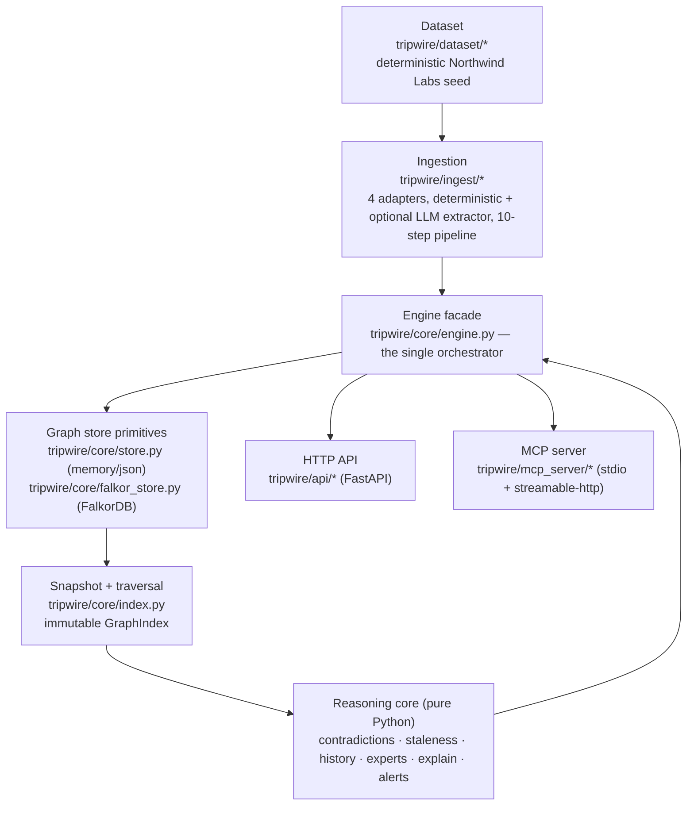

# Tripwire — Architecture

## 1. The problem and the thesis

A company's decisions rest on facts that quietly stop being true. An EU launch
proceeds because a hosting partner holds an EU compliance certification; a pricing
tier is priced against a contracted rate; a regulatory sign-off relies on a single
attestation. When one of those underlying facts changes, nothing in the
organisation connects the change to the decisions that depended on it, and nobody
is told.

Tripwire models the *provenance* of decisions in a graph — decisions assume
assumptions, assumptions are supported by facts, facts are stated by source
records — and, when a fact is contradicted, walks that graph to find what is
affected, explains *why* using real records, and raises a de-duplicated alert.

The product thesis is a **restraint thesis**: software that cries wolf is ignored.
Tripwire therefore propagates a *suspicion* (`POTENTIALLY_STALE`) and never
auto-invalidates anything; a decision only becomes `STALE` through an explicit,
human-confirmed review, and only when no independent supporting evidence survives.
Every classification it produces (temporal succession vs. genuine conflict,
ambiguous prior state vs. a real contradiction, unverified rumour vs. established
truth) is designed to prefer the honest "I am not sure yet" over a confident wrong
answer.

## 2. Layer diagram



The dataset is fed to the engine directly (seeder) **or** through the ingestion
pipeline (external records). Both write through the engine; the engine writes
through the store; every read path snapshots the store into an immutable
`GraphIndex` and runs pure reasoning over it.

## 3. Module-by-module map

### 3.1 Dataset (`tripwire/dataset/`)

| File | Responsibility | Key entry point |
| --- | --- | --- |
| `entities.py` | Declarative, data-only definitions of the Northwind Labs people, teams, systems, projects, decisions, assumptions, facts and ownership. No behaviour, no clock, no randomness. | `PEOPLE`, `TEAMS`, `SYSTEMS`, `PROJECTS`, `DECISIONS`, `ASSUMPTIONS`, `FACTS`, `OWNERSHIP`, `resolve_entity_id()` |
| `sources.py` | The 60 source artifacts (40 Slack messages, 15 tickets, 3 PRDs, 2 meeting notes) with explicit `mentions`/`states`/`participants`. | `SLACK`, `TICKETS`, `PRDS`, `MEETING_NOTES`, `ALL_SOURCES` |
| `northwind.py` | Deterministic builder that turns the data into `Node`/`Edge` objects; the dataset manifest; the six demo scenarios. | `build_subgraph()`, `dataset_manifest()`, `scenario_event()`, `SCENARIOS` |

### 3.2 Ingestion (`tripwire/ingest/`)

| File | Responsibility | Key entry point |
| --- | --- | --- |
| `base.py` | Adapter/record/extractor contracts, the adapter registry, extraction validation. | `SourceAdapter`, `SourceRecord`, `validate_extraction()`, `get_adapter()`, `adapter_catalog()` |
| `adapters/slack.py` | Slack message / webhook-shaped record → `Message`. | `SlackAdapter.to_record()` |
| `adapters/tickets.py` | Ticket record → `Document(doc_type="ticket")`; records the resolver. | `TicketAdapter.to_record()` |
| `adapters/prd.py` | PRD record → `Document(doc_type="prd")`. | `PrdAdapter.to_record()` |
| `adapters/meeting_notes.py` | Meeting note → `Document(doc_type="meeting_note")`; keeps author vs. participant separate. | `MeetingNotesAdapter.to_record()` |
| `deterministic.py` | Offline, rule-based extractor; everything it emits is unverified + `NEEDS_REVIEW`. | `DeterministicExtractor.extract()` |
| `llm_extractor.py` | Optional OpenAI-compatible client for extraction and semantic comparison; output validated before use. | `LLMExtractor`, `HttpLLMClient`, `build_llm_client()` |
| `pipeline.py` | The ten-step ingestion pipeline; delegates every write to the engine. | `IngestionPipeline.ingest()`, `normalise_payload()` |

### 3.3 Graph store (`tripwire/core/`)

| File | Responsibility | Key entry point |
| --- | --- | --- |
| `store.py` | `GraphStore` primitive contract + `MemoryGraphStore` + `JsonGraphStore` + `create_store()`. | `GraphStore.upsert_node/upsert_edge/…`, `create_store()` |
| `falkor_store.py` | FalkorDB adapter (same primitives, over the Redis protocol) plus the proposal's original Cypher and its corrected form. | `FalkorGraphStore`, `PROPOSED_PROPAGATION_CYPHER`, `CORRECTED_PROPAGATION_CYPHER`, `native_candidate_decisions()` |
| `models.py` | `Node`, `Edge`, `Subgraph`, `PathStep`, `EvidencePath`; the merge rules. | `Node.merge()`, `Edge.merge()` |
| `index.py` | Immutable in-memory snapshot with adjacency and breadth-first traversal. | `GraphIndex`, `GraphIndex.traverse()`, `provenance_for()` |
| `schema.py` | The single source of truth for node types, relationship types, status vocabularies and validation. | `NODE_TYPES`, `REL_TYPES`, `ADDED_RELATIONSHIPS`, `validate_node_payload()` |
| `ids.py` | Deterministic id generation and de-duplication keys (pure functions). | `fact_id()`, `message_id()`, `alert_id()`, `event_id()` |
| `timeutil.py` | ISO-8601 parsing/normalisation helpers. | `parse_iso()`, `now_iso()` |
| `errors.py` | Typed error hierarchy with API/MCP codes. | `TripwireError`, `NotFoundError`, `ValidationError`, `TransitionError`, … |

### 3.4 Reasoning core (all plain Python above the store)

| File | Responsibility | Key entry point |
| --- | --- | --- |
| `contradictions.py` | Classify a new fact against existing knowledge into one of six kinds. Pure, read-only. | `find_contradictions()`, `EXPLICIT_RULES`, `ATTRIBUTE_ALIASES` |
| `staleness.py` | Plan propagation of a changed fact to affected decisions/projects; compute certainty and alternate evidence. Pure. | `plan_propagation()`, `entity_certainty()`, `DEPENDENCY_RELATIONSHIPS` |
| `history.py` | Bi-temporal queries over the two clocks. Pure, read-only. | `belief_at()`, `valid_at()`, `fact_timeline()`, `dependencies_at()` |
| `experts.py` | Contribution-based expert ranking and the shadow-org signal. Pure. | `find_experts()`, `CONTRIBUTION_WEIGHTS` |
| `explain.py` | Provenance/explanation assembly; never claims evidence the graph lacks. | `explain_path()`, `explain_decision()`, `explain_alert()`, `explain_fact_change()` |
| `alerts.py` | Alert creation, de-duplication, the status machine, promotion/dismissal cascades. | `create_alert()`, `transition_alert()`, `promote_decision()`, `dedupe_key()` |

### 3.5 Engine facade

| File | Responsibility | Key entry point |
| --- | --- | --- |
| `engine.py` | **The single orchestrator.** Owns the store, the optional LLM and settings; wires assertion → contradiction → propagation → alerts; exposes every read operation the surfaces need. | `GraphEngine.trigger_event()`, `GraphEngine.ingest_source()`, `GraphEngine.apply_staleness()` |

### 3.6 Surfaces

| File | Responsibility |
| --- | --- |
| `api/app.py` | FastAPI app factory; mounts 14 routers; exception handlers; CORS; request logging. |
| `api/routers/*.py` | One router per domain: `health`, `demo`, `dataset`, `graph`, `decisions`, `facts`, `experts`, `contradictions`, `staleness`, `alerts`, `history`, `search`, `sources`, `ingest`. |
| `mcp_server/tools.py` | `TripwireTools` — 13 tool callables bound to one engine. |
| `mcp_server/server.py` | Registers those callables on an `MCPServer`; stdio + streamable-http transports. |

## 4. The central design decision: stores are primitive-only; all reasoning lives above them

`GraphStore` defines a small primitive contract — `upsert_node`, `upsert_edge`,
`delete_node`, `delete_edge`, `get_node`, `get_nodes`, `get_edges`, `clear` — plus
convenience traversal built on top (`neighbors`, `edges_into`, `subgraph`, …).
Nothing above the store is allowed to reach into storage internals.

Everything that constitutes *reasoning* — contradiction detection, staleness
propagation, explanation, bi-temporal history, expert ranking, alert de-duplication
and the status machine — is implemented exactly once, in plain Python, over an
immutable `GraphIndex` snapshot. The HTTP API (`tripwire/api`) and the MCP tools
(`tripwire/mcp_server/tools.py`) are thin adapters that call the *same*
`GraphEngine` methods. The test-suite calls those same methods directly.

**What this buys**

* **One implementation, three surfaces.** A reasoning bug is fixed once. The HTTP
  API and MCP tools cannot drift, because neither contains reasoning.
* **Unit-testability without a database.** The hardest logic (`contradictions`,
  `staleness`) is pure and takes a `GraphIndex`, so it is tested with plain Python
  values, no server.
* **Backend portability.** The same engine runs over the in-memory store, the JSON
  store (no Docker) and FalkorDB, because the engine only ever sees the primitive
  interface.
* **Determinism.** Reads are snapshots; nothing mutates underneath a traversal.

**What it costs**

* **The database cannot optimise the reasoning.** Propagation is a Python
  breadth-first walk over a snapshot, not a graph-database traversal. On the
  intended scale (hundreds to low thousands of nodes) that is fine; at a much
  larger scale the snapshot itself becomes the bottleneck.
* **A snapshot per operation.** Each reasoning call rebuilds a `GraphIndex` from
  the store (`GraphEngine.index()`), trading memory and a full read for
  predictable semantics.
* **The FalkorDB native traversal is an *optimisation*, not the authority.** The
  adapter exposes `native_candidate_decisions()` (corrected variable-length Cypher),
  but the Python engine stays authoritative. That keeps parity risk contained to a
  measurable optimisation — at the cost of a second code path that must be kept
  honest (see §10).

## 5. End-to-end flow for the headline scenario

Scenario `frankfurt_compliance_revoked`: the Frankfurt partner's EU compliance
certification is revoked, from a verified internal compliance source.

1. **Trigger.** `POST /api/demo/trigger-event {"scenario": "frankfurt_compliance_revoked"}`
   → `tripwire/api/routers/demo.py` → `GraphEngine.trigger_event(payload)`.
2. **Spec resolution.** `GraphEngine._event_spec()` calls
   `tripwire.dataset.northwind.scenario_event()` to obtain the fact spec and the
   source record; `moment` is taken from the spec's `recorded_at`.
3. **Assertion.** `GraphEngine.assert_fact()` resolves the subject
   (`ensure_entity("Frankfurt Hosting Partner")` → `system:frankfurt-hosting-partner`),
   stores the source (`ensure_source()`, an `AUTHORED` edge) and computes the
   deterministic id via `ids.fact_id(subject_id, attribute, value, valid_from)` →
   `fact:5f3054083121`. A `STATES` edge links the source to the fact; a
   `FACT_ASSERTED` event is recorded.
4. **Contradiction detection.** `GraphEngine.find_contradictions()` →
   `contradictions.find_contradictions()` compares the new fact with every existing
   `Fact`. It returns `contradiction` against
   `fact:frankfurt-partner-compliance-valid` (confidence `0.936`, rule
   `compliance_revocation`) plus five `additive` candidates.
5. **Recording the contradiction.** `GraphEngine.record_contradiction()` writes the
   `CONTRADICTS` edge (`new -> old`), and — because the new fact is verified —
   closes the old fact's real-world interval (`valid_to = 2026-02-20T08:15:00Z`),
   closes its transaction interval (`recorded_to`), and sets it `INVALIDATED`; a
   `FACT_CHANGE` event is recorded.
6. **Propagation.** `GraphEngine.plan_staleness()` → `staleness.plan_propagation()`
   walks `Fact <-SUPPORTED_BY- Assumption <-ASSUMES- Decision`, then `DEPENDS_ON`
   (inward) and `IMPACTS` (outward) to find affected entities with certainty and
   alternate evidence.
7. **Applying propagation.** `GraphEngine.apply_staleness()` writes
   `POTENTIALLY_STALE` (never `STALE`) onto each affected decision and a
   `staleness_flag` on projects, writes a `STALED` edge from the fact, records a
   `STATUS_CHANGE` event, and raises one de-duplicated alert per affected entity
   (via `_raise_alert` → `alerts.create_alert`), assigning reviewers from
   `_reviewers_for()` → `experts.find_experts()`.
8. **Result.** Eight affected entities. `decision:eu-launch` is `potential` (its
   assumption still has the surviving SOC 2 fact), `decision:legal-signoff-eu` is
   `confirmed` (its assumption has nothing left). All `status_after` values are
   `POTENTIALLY_STALE`. Eight alerts are raised.

## 6. Write-path discipline

**The engine is the single orchestrator.** Every mutation goes through a
`GraphEngine` method. `put_node` / `put_edge` are the only low-level write paths;
they delegate to the store. The API never writes; it calls the engine. The MCP
tools never write; they call the engine.

**Ingestion goes through the engine.** `GraphEngine.ingest_source()` delegates to
`IngestionPipeline(self)`, and the pipeline holds only a reference to the engine —
it "never touches the store directly; every write goes through the engine so there
is one write path with one set of de-duplication rules"
(`tripwire/ingest/pipeline.py`). `POST /api/ingest` delegates to
`engine.ingest_source` and implements no ingestion logic of its own
(`tripwire/api/routers/ingest.py`).

**Alerts go through the engine.** The alert functions (`create_alert`,
`transition_alert`, `promote_decision`) are the alert subsystem's implementation,
but they are only invoked from engine code paths (or from thin API/MCP adapters
that call `GraphEngine.review_alert` / `GraphEngine.get_alert`).

**`upsert_*` merges instead of replacing.** An upsert reads the existing node/edge
and merges the incoming one rather than overwriting it, using `Node.merge()` /
`Edge.merge()`:

* `other`'s non-`None` properties win (later knowledge supersedes),
* `IMMUTABLE_ONCE_SET` keys (`created_at`, `recorded_at`, `first_seen_at`) are
  never overwritten once present,
* a `None` value never erases existing data,
* edges are keyed by the identity triple `(src, rel, dst)`, so re-adding the same
  relationship updates it rather than duplicating it.

This is what makes **seed idempotency** real: the seeder can run twice and change
no counts, because every node re-merges into itself and every edge re-merges into
its identity triple. It also prevents the classic "re-ingest clobbers
`recorded_at`" bug: re-ingesting an old source does not pretend Tripwire learned it
today. The FalkorDB adapter reproduces these exact rules in Python (it reads the
existing node, merges with the same `Node.merge`, then writes) rather than relying
on `MERGE … SET n += $props`, which would blindly overwrite.

## 7. Restraint as a first-class design property

Restraint is not a UI nicety; it is encoded in the data model and the algorithms.

* **`POTENTIALLY_STALE` vs `STALE`.** Propagation only ever writes
  `POTENTIALLY_STALE` (`DECISION_STATUSES`). Promotion to `STALE` happens in exactly
  one place — `alerts.promote_decision()`, reached only via an explicit
  `CONFIRMED_STALE` alert transition — and `GraphEngine.set_decision_status()` also
  refuses to set `STALE` unless `confirm=true`.
* **`potential` vs `confirmed` certainty.** `staleness.entity_certainty()` returns
  `confirmed` only when the connecting assumption has *no surviving independent
  support at all*. `confirmed` is explicitly defined as "the recorded rationale is
  no longer supported anywhere, so a human should look" — never "invalid".
* **Alternate-evidence reporting.** When other facts still support the assumption,
  they are returned in `alternate_evidence` and the certainty stays `potential`.
  In the headline scenario the surviving fact is
  `fact:frankfurt-partner-soc2-attestation-valid`, reported on the EU Launch
  decision, the EU Launch project, the pricing and hiring decisions.
* **Unverified sources never auto-propagate a status change.** If the changed fact
  is unverified or merely `CONTESTED`, `plan_propagation()` forces every certainty to
  `potential` regardless of graph shape. An unverified contradiction only marks the
  original fact `CONTESTED` and leaves both intervals open
  (`record_contradiction()`); the new fact is marked `UNCERTAIN`.
* **`STALE` requires an explicit confirmed review.** Nothing in propagation writes
  `STALE`; `test_trigger_event_headline_scenario` asserts
  `all(impact["status_after"] != "STALE" ...)` and that the three unrelated
  decisions remain `ACTIVE`.

The same restraint shows up in contradiction detection: unknown attributes default
to *functional* (so a conflict surfaces for review rather than being missed), and
an LLM verdict may only *soften* a rule verdict — never confirm one.

## 8. Determinism

**What is deterministic**

* **Ids.** Every id generator in `ids.py` is a pure function. Curated entities get
  slugs (`person:priya-raman`); source artifacts are keyed by
  `(source_system, external_id)`; facts are a content hash over
  `(statement_key, valid_from, discriminator)`; alerts and events are hashes over
  their logical identity.
* **Seeding.** `build_subgraph()` is a pure function with no randomness and no
  clock read, so seeding twice produces byte-identical content and identical
  counts.
* **De-duplication keys.** An alert's identity is
  `old_fact_id | new_fact_id | entity_id`, so replaying an event resolves to the
  same alert instead of creating a second one.
* **Event ids exclude the clock.** `GraphEngine._event()` derives the id as
  `event_id(kind, subject_id, short_hash(summary))` — deliberately *without* the
  wall-clock moment — so replaying an identical event updates the existing `Event`
  node instead of appending a duplicate history entry.
* **Ordering.** Store reads are sorted (`label, id` for nodes; `src, rel, dst` for
  edges), so responses are reproducible.
* **Expert recency (with a caveat).** `find_experts(now=None)` uses
  `_latest_timestamp(index)` — the newest `timestamp`/`recorded_at` across *all*
  nodes — as the recency reference rather than reading the wall clock itself. After
  seeding, however, the newest such value is the seed `Event` node's `recorded_at`,
  which `seed_demo()` sets from `now_iso()`. So the ranking is consistent within a
  run but its absolute recency factors depend on how long ago the graph was seeded;
  pass `now` explicitly for a fully deterministic reference.

**What is not deterministic**

* **Wall-clock timestamps.** When a caller does not supply `recorded_at`/`moment`,
  `now_iso()` is used for event timestamps and status-change times. The demo
  scenarios supply fixed timestamps (`recorded_at`), which is why replay tests are
  stable.

**How replay safety is achieved** — deterministic ids (§`ids.py`), content-hash
dedupe keys, event ids that exclude the clock, idempotent merges, and monotonic
status writes. `apply_staleness()` refuses to regress an entity that is already
`POTENTIALLY_STALE`/`STALE`/`SUPERSEDED`/`ARCHIVED`; re-detection of an
already-recorded `CONTRADICTS` edge short-circuits in `find_contradictions` and is
skipped in `record_contradiction`.

## 9. Extension points

* **Adding a source adapter.** Subclass `SourceAdapter` in
  `tripwire/ingest/adapters/`, implement `to_record()`, declare `name`,
  `source_system`, `label`, `default_doc_type`, `input_shape` and
  `integration_type`, and register it in `base._build_registry()`. Validation,
  provenance, entity resolution, de-duplication, confidence handling and event
  recording are already handled by the shared pipeline. `GET /api/ingest/adapters`
  reflects the catalogue automatically.
* **Adding a node type or relationship type.** Add the name to `NODE_TYPES` or to
  `_SPEC_REL_TYPES` / `ADDED_RELATIONSHIPS` in `tripwire/core/schema.py`. Because
  the store layer validates labels/relationships against those tuples, the
  FalkorDB adapter will accept the new vocabulary with no code change. If it needs
  a controlled status vocabulary, extend `_status_vocabulary()`.
* **Adding a store backend.** Implement the `GraphStore` primitives (the abstract
  methods in `store.py`) and add a branch to `create_store()`. The entire reasoning
  core works unchanged, because it only consumes `GraphIndex`.
* **Swapping in an LLM.** Provide an object exposing `compare_facts(old, new)` (for
  the contradiction path) and/or an `LLMClient` (for `LLMExtractor`). Configure it
  via `Settings.llm_provider`/`llm_api_key`/`llm_model`; `build_llm_client()`
  returns `None` when unconfigured, and any failure degrades to the deterministic
  path rather than failing ingestion.

## 10. Known limitations and untested paths

These are stated plainly and were verified against the code in this checkout.

* **FalkorDB was never exercised against a live server.** `falkordb` is the default
  configured backend, but no live server is reachable in this environment and the
  Docker-based startup path is not used here. `FalkorGraphStore` is implemented
  (indices, merge-on-read, parameterised predicates, the corrected native
  traversal) but its runtime behaviour against a real FalkorDB instance is **not
  exercised by the automated suite**. In particular, the module docstrings of
  `tripwire/core/store.py` and `tripwire/core/falkor_store.py` state that
  `tests/test_falkor_parity.py` asserts native-vs-Python parity — **that test file
  does not exist in this repository** (the whole test suite is `tests/test_api.py`
  and `tests/test_mcp_tools.py`). Treat "the native traversal returns identical
  decisions" as a design intention, not a machine-verified fact.
* **The LLM path has never run against a live provider.** `HttpLLMClient` is
  implemented against the OpenAI-compatible chat-completions shape and is
  request-shape-tested with an injected `httpx` mock transport, but no API key is
  configured here, so neither extraction nor semantic comparison has been exercised
  against a real provider.
* **The JSON store has no cross-process transaction.** Writes are atomic
  (temp file + `os.replace`) and readers reload when the file changes, but
  concurrent writers are **last-write-wins** (documented in
  `JsonGraphStore`'s docstring). Used for the offline demo/API/MCP sharing, not for
  concurrent multi-writer production.
* **`staleness.py` contains dead code.** `plan_propagation()` returns at its first
  `return plan`; a second, unreachable copy of the body (`DIRECTION_IN` variant)
  follows it. The live implementation is the `DIRECTION_BOTH` one. This is a
  maintenance hazard, not a behavioural one, and is noted here so a reader does not
  mistake the dead copy for the active algorithm.
* **The headline-seeded dependency edges are curated, not inferred.** `ASSUMES`,
  `SUPPORTED_BY`, `DEPENDS_ON` and `IMPACTS` come from the dataset/PRD data. The
  ingestion pipeline deliberately does **not** fabricate dependency edges from
  prose; extracted decisions/assumptions arrive as unlinked, `NEEDS_REVIEW`
  candidates.

## 11. How to verify this document

The suite requires no Docker, no network and no credentials (all tests use an
in-memory store).

```powershell
# whole suite
python -m pytest -q

# HTTP API contract and the headline scenario / restraint guarantees
python -m pytest tests/test_api.py -q

# MCP tool surface, read-only guarantees, propagation and history modes
python -m pytest tests/test_mcp_tools.py -q
```

Claim → test file map (test function names are real; run them with
`python -m pytest tests/<file>::<name> -q`):

| Claim in this document | Covered by |
| --- | --- |
| API is a thin adapter over the engine; error envelope is uniform | `tests/test_api.py::test_error_envelope_shape_is_consistent`, `…::test_openapi_metadata` |
| Seeding is idempotent; counts match the manifest (7 decisions, 13 facts) | `tests/test_api.py::test_seed_is_idempotent`, `…::test_demo_state_after_seed` |
| The headline scenario propagates, is `potential` for EU Launch and `confirmed` for legal sign-off, and never writes `STALE` | `tests/test_api.py::test_trigger_event_headline_scenario` |
| Unrelated decisions are left `ACTIVE` (restraint) | `tests/test_api.py::test_trigger_event_headline_scenario`; `tests/test_mcp_tools.py::test_trigger_demo_event_runs_the_full_pipeline` |
| Reset restores pristine state | `tests/test_api.py::test_reset_restores_state` |
| `STALE` needs explicit confirmation | `tests/test_api.py::test_decision_status_transition_and_stale_confirmation` |
| Propagation dry-run writes nothing; apply writes flags | `tests/test_api.py::test_staleness_dry_run_does_not_write`, `…::test_staleness_apply_writes`; `tests/test_mcp_tools.py::test_propagate_staleness_dry_run_is_non_destructive`, `…::test_propagate_staleness_apply_writes_flags` |
| Alternate evidence is reported | `tests/test_mcp_tools.py::test_propagate_staleness_reports_alternate_evidence` |
| Contradiction detection is read-only for a hypothetical candidate | `tests/test_mcp_tools.py::test_find_contradictions_hypothetical_candidate_is_read_only` |
| Hidden expert ranks first / shadow signal | `tests/test_api.py::test_experts_hidden_expert_ranked_first`; `tests/test_mcp_tools.py::test_find_experts_shows_shadow_signal` |
| Explanations report missing evidence honestly | `tests/test_mcp_tools.py::test_explain_path_reports_missing_node_honestly`, `…::test_explain_decision_missing_is_honest` |
| Bi-temporal belief vs. validity | `tests/test_mcp_tools.py::test_history_query_belief_is_transaction_time_correct`, `…::test_history_query_valid_is_real_world_time_correct` |
| Alert status machine rejects invalid transitions | `tests/test_api.py::test_alert_review_invalid_transition_is_409`; `tests/test_mcp_tools.py::test_review_alert_valid_transition_and_invalid_transition` |
| `POST /api/ingest` delegates to the engine | `tests/test_api.py::test_ingest_record_guarded` (see §12) |

## 12. Status of the test suite at the time of writing

`python -m pytest -q` reports **89 passed, 1 failed**. The failure is
pre-existing and unrelated to documentation:

```
FAILED tests/test_api.py::test_ingest_record_guarded
    assert 400 in (200, 501)
```

`test_ingest_record_guarded` posts `{"source": "slack", "kind": "message"}`
apparently expecting the guarded `501` ("ingestion not available") behaviour, but
ingestion **is** implemented: the request reaches `engine.ingest_source` →
`IngestionPipeline`, the `slack` adapter rejects the record (missing
`external_id`/`text`), and the API returns `400`. The test asserts the older
guarded contract (`200` or `501`) and is stale with respect to the current
"`POST /api/ingest` delegates to `engine.ingest_source`" behaviour. No code was
modified while writing these documents.
